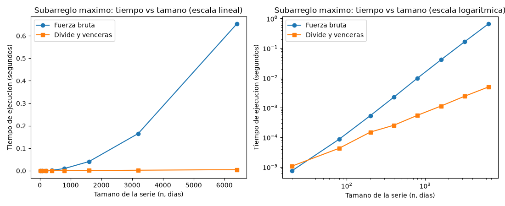

# Laboratorio evaluativo 2 — Dividir y vencer

**Nombre completo:** John Sebastian Gomez Gonzalez

## Cómo correr esto

Con el entorno virtual de la raíz del repo activado (ver Laboratorio 2 del curso):

```bash
source venv/Scripts/activate      # o venv/bin/activate en Linux/Mac
pip install -r requirements.txt
cd lab2-divide-y-vencer
python pruebas.py                 # si todo está bien imprime "Todas las pruebas pasaron"
python medicion.py                # imprime los tiempos y guarda graficas/tiempo_vs_n.png
```

---

## Parte 1 — Implementar y verificar

Código: [`subarreglo.py`](subarreglo.py) con las tres funciones y [`pruebas.py`](pruebas.py) con las verificaciones.

En las pruebas comparo siempre la **suma** y no los índices, porque si hay dos tramos empatados cualquiera de los dos es válido. Lo que verifico es:

- La serie de ocho días del enunciado (`[-3, 5, -2, 8, -6, 3, 9, -4]`), que tiene que dar 17 en las dos funciones.
- Series de un solo elemento: uno positivo, uno negativo y un cero.
- Una serie con todo negativo, donde gana el valor menos malo.
- Una serie con todo positivo, donde el tramo es la serie completa.
- Un caso donde el mejor tramo cruza el punto medio: `[2, -9, 4, 6, 5, -8, 1]`, con tramo de los índices 2 a 4 y suma 15. Con este caso se prueba `suma_cruzada`, porque el mejor tramo no está entero en ninguna de las dos mitades.
- Que las dos funciones no modifican la lista que reciben.
- 40 listas aleatorias de entre 1 y 80 elementos (semilla fija) en las que la fuerza bruta y el divide y vencerás tienen que dar la misma suma.

---

## Parte 2 — Medir y graficar

Código: [`medicion.py`](medicion.py).

Medí ocho tamaños: 20, 80, 200, 400, 800, 1600, 3200 y 6400 días. Las series son de enteros entre -100 y 100 con semilla fija, y para cada tamaño las dos funciones reciben exactamente la misma lista. Antes de medir, el script verifica que las dos den la misma suma. Cada medición se repite 5 veces con `time.perf_counter()`, se cronometra solo la llamada al algoritmo (no la generación de datos) y en la gráfica y en la tabla uso el promedio.

La gráfica tiene dos paneles con los mismos datos: a la izquierda en escala lineal y a la derecha en escala logarítmica en ambos ejes. Agregué la logarítmica porque en la lineal la curva de divide y vencerás queda pegada al eje y no se ven los tamaños pequeños.



Valores medidos (promedio de 5 corridas):

| n (días) | Fuerza bruta (s) | Divide y vencerás (s) |
|---|---|---|
| 20 | 0,000007 | 0,000011 |
| 80 | 0,000086 | 0,000043 |
| 200 | 0,000539 | 0,000150 |
| 400 | 0,002263 | 0,000256 |
| 800 | 0,009875 | 0,000552 |
| 1600 | 0,041021 | 0,001135 |
| 3200 | 0,165651 | 0,002424 |
| 6400 | 0,652660 | 0,004933 |

---

## Parte 3 — Análisis

**1. Recurrencia.** Mi `subarreglo_maximo` parte el rango en dos mitades y se llama una vez con cada una, por eso hay a = 2 subproblemas, cada uno de tamaño n/2 (b = 2). Además, en cada llamada corre `suma_cruzada`, que recorre desde el punto medio hacia la izquierda y hacia la derecha: entre las dos pasadas revisa como mucho los n elementos del rango, así que cuesta Θ(n). Escoger el mejor de los tres candidatos es comparar tres sumas, trabajo constante que queda absorbido por el Θ(n). La recurrencia es T(n) = 2T(n/2) + Θ(n). Por el método maestro, n^(log_b a) = n^(log₂2) = n. Como f(n) = Θ(n) tiene el mismo orden que n^(log_b a), estoy en el caso 2 (f(n) = Θ(n^(log_b a) · log⁰n)) y T(n) = Θ(n log n). La fuerza bruta es Θ(n²) porque el ciclo de `inicio` va de 0 a n−1 y para cada valor el de `fin` recorre desde `inicio` hasta n−1; son n + (n−1) + … + 1 = n(n+1)/2 pasadas, y cada una hace una suma y una comparación.

**2. Lo medido contra lo esperado.** En la gráfica lineal la fuerza bruta se dispara hacia arriba (0,04 s con n = 1600 y 0,65 s con n = 6400), mientras que divide y vencerás casi no se despega del eje (0,005 s con n = 6400). En la logarítmica las dos se ven casi como rectas, la de la fuerza bruta con una pendiente cercana a 2 y la de divide y vencerás cercana a 1. Al duplicar n de 3200 a 6400, el tiempo de la fuerza bruta se multiplicó por 0,6527 / 0,1657 ≈ 3,94, muy cerca del 4 de Θ(n²). El de divide y vencerás se multiplicó por 0,004933 / 0,002424 ≈ 2,04; para Θ(n log n) esperaba 2 · log₂6400 / log₂3200 ≈ 2,17. Quedó un poco por debajo, pero cerca y lejos del 4, así que coincide con n log n. En el par 1600 → 3200 los factores fueron 4,04 y 2,14.

**3. Tamaños pequeños.** Sí encuentro un cruce. Con n = 20 la fuerza bruta es más rápida (7 µs contra 11 µs), pero con n = 80 divide y vencerás ya gana (43 µs contra 86 µs). El cruce está entre 20 y 80 días. No medí por separado de dónde sale la diferencia en tamaños chicos; lo más probable es que las llamadas recursivas y las tuplas que se arman en cada llamada pesen más que el ahorro cuando n es tan pequeño, pero eso es una hipótesis y no algo que probé.

**4. ¿Cuándo conviene dividir?** Para hallar el máximo de un arreglo, dividir por la mitad da T(n) = 2T(n/2) + Θ(1), porque combinar es comparar dos números. Aquí n^(log₂2) = n y f(n) = Θ(1) es polinomialmente menor, caso 1 del método maestro, y T(n) = Θ(n). Recorrerlo con un solo ciclo ya es Θ(n), así que dividir no mejora nada y solo suma llamadas recursivas. En el subarreglo máximo sí conviene porque la alternativa directa es Θ(n²) y el costo lineal de combinar deja el total en Θ(n log n).

**5. Concepto para la gerente.** Recomiendo divide y vencerás. Con 6400 días ya es unas 132 veces más rápido (0,0049 s contra 0,65 s), y la brecha crece con n. **Lo siguiente es una estimación, no una medición.** Para 1.000.000 de registros, n es 156,25 veces el de 6400. La fuerza bruta crece como n², así que tardaría 0,6527 · 156,25² ≈ 15.900 s, unas 4,4 horas. Divide y vencerás crece como n log n, con factor 156,25 · (log₂10⁶ / log₂6400) ≈ 156,25 · 1,58 ≈ 246, o sea 0,004933 · 246 ≈ 1,2 s. Supongo que el computador es el mismo y que las curvas mantienen su forma; con series tan grandes la memoria puede cambiar los valores exactos, pero no la diferencia entre horas y segundos.
