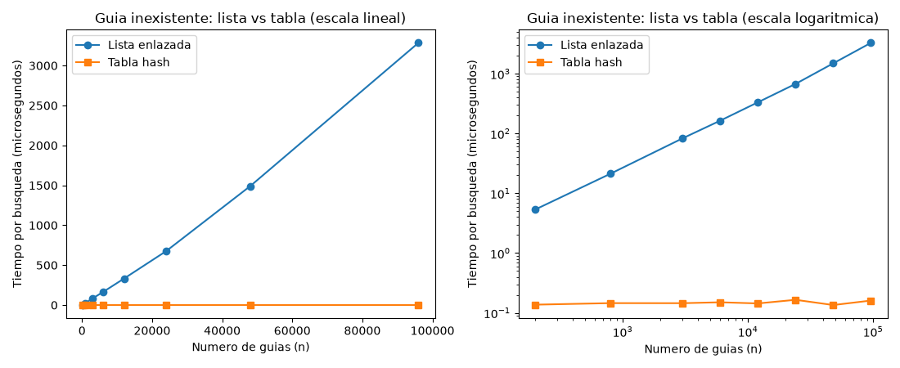
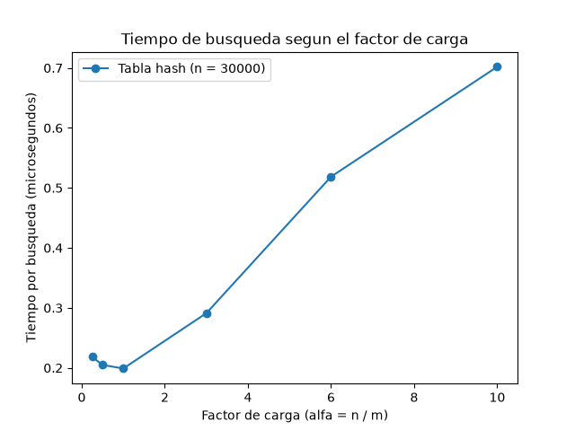

# Laboratorio evaluativo 3 — Estructuras de datos

**Nombre completo:** John Sebastian Gomez Gonzalez

## Cómo correr esto

Con el entorno virtual de la raíz del repo activado (ver Laboratorio 2 del curso):

```bash
source venv/Scripts/activate      # o venv/bin/activate en Linux/Mac
pip install -r requirements.txt
cd lab3-estructuras-datos
python pruebas.py                 # si todo está bien imprime "Todas las pruebas pasaron"
python medicion.py                # imprime los tiempos y guarda las dos gráficas en graficas/
```

---

## Parte 1 — Implementar y verificar

Código: [`estructuras.py`](estructuras.py) con `Nodo`, `ListaEnlazada` y `TablaHash`, y [`pruebas.py`](pruebas.py) con las verificaciones.

`ListaEnlazada.buscar` avanza nodo por nodo con un `while`, sin recursión, y `TablaHash` guarda una `ListaEnlazada` en cada casilla. No usé `dict`, `set` ni `hash()` dentro de las estructuras. Las pruebas con `assert` cubren:

- Búsquedas exitosas e infructuosas en la lista y en la tabla (con `m = 11`), usando las cuatro guías de la serie de ejemplo del enunciado.
- La colisión forzada con `m = 7`: las guías 10, 24 y 17 dan la casilla 3, se insertan las tres y se encuentran después, la lista de esa casilla tiene longitud 3, y la guía 31, que también cae en la casilla 3 pero no está guardada, devuelve `None`.
- `factor_carga()` igual a `3 / 7` después de esas tres inserciones, y 0 en una tabla vacía.
- Lista y tabla vacías.
- 25 colecciones aleatorias (de 1 a 400 guías y de 1 a 80 casillas, con semilla fija) donde la lista y la tabla devuelven el mismo estado para todas las guías existentes y `None` para guías inexistentes.

---

## Parte 2 — Medir y graficar

Código: [`medicion.py`](medicion.py).

Las guías son enteros distintos de diez dígitos generados con semilla fija, y en cada n la lista y la tabla se cargan con las mismas guías. Solo se cronometran las búsquedas (con `time.perf_counter()`), no la construcción ni la generación de datos. Cada medición hace una pasada de calentamiento sin medir y luego 5 repeticiones con el recolector de basura apagado, y uso el promedio del tiempo por búsqueda. Antes de medir, el script verifica que la lista y la tabla den el mismo estado en una muestra de 300 guías existentes.

**Experimento A** (200 búsquedas de guías inexistentes por cada n, tabla con `m` primo cercano a n / 2, o sea α ≈ 2). La gráfica tiene dos paneles con los mismos datos, en escala lineal y en escala logarítmica, porque en la lineal la tabla queda pegada al eje.



| n (guías) | m de la tabla | Lista (µs por búsqueda) | Tabla (µs por búsqueda) |
|---|---|---|---|
| 200 | 101 | 5,348 | 0,137 |
| 800 | 401 | 21,300 | 0,145 |
| 3000 | 1511 | 82,839 | 0,145 |
| 6000 | 3001 | 163,857 | 0,150 |
| 12000 | 6007 | 332,336 | 0,144 |
| 24000 | 12007 | 675,454 | 0,165 |
| 48000 | 24001 | 1490,327 | 0,135 |
| 96000 | 48017 | 3285,091 | 0,160 |

**Experimento B** (n = 30000 guías fijas, 20000 búsquedas de guías inexistentes por medición): cambio `m` para variar α.



| α | m | Tabla (µs por búsqueda) |
|---|---|---|
| 0,25 | 120011 | 0,218 |
| 0,5 | 60013 | 0,205 |
| 1 | 30011 | 0,199 |
| 3 | 10007 | 0,291 |
| 6 | 5003 | 0,519 |
| 10 | 3001 | 0,702 |
